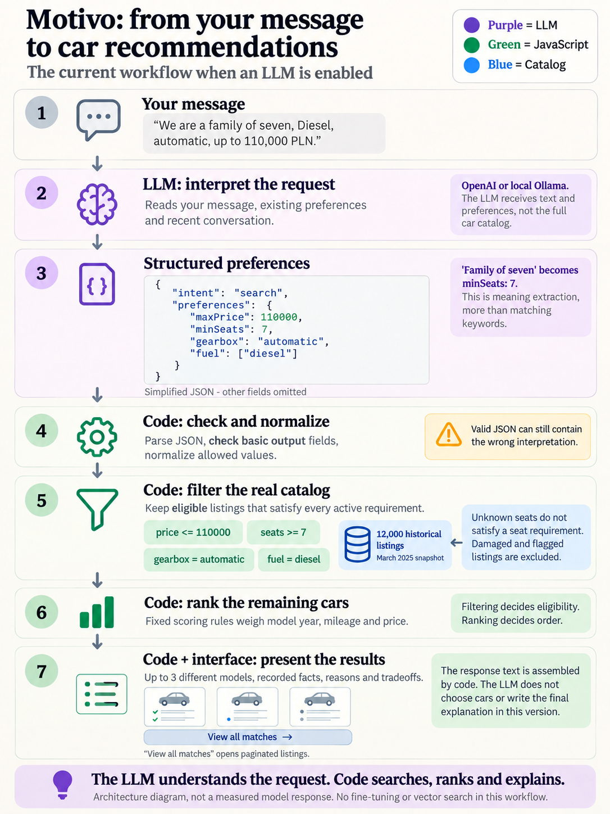
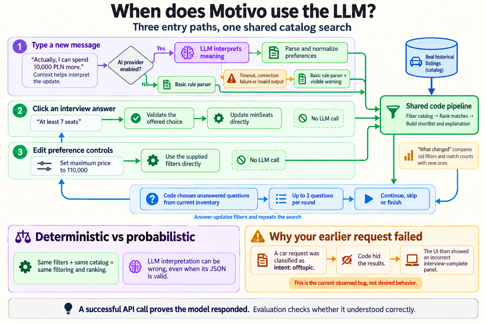

# How Motivo works

**Version note:** These images capture the earlier workflow. Motivo now offers written feedback as the main refinement step. The LLM receives the shown shortlist and can return one targeted clarification question; code preserves the saved filters while that question is pending. Model responses declare which preference fields they update. Suggested interview questions remain optional. See [feedback scenarios](../feedback-scenarios.md) for the new flow. The former misleading interview panel is now suppressed for clarification, greeting and unrelated responses.

These diagrams describe the current implementation when AI interpretation is enabled. They do not confirm which provider is active in a running server.

## 1. From a message to recommendations

Read this diagram from top to bottom.

The LLM performs **structured preference extraction**: it translates the meaning of a message into fields the program understands. For example, "a family of seven" should become `minSeats: 7`. The same model also classifies the message as a search, greeting or unrelated request.

The model receives the current message, previous preferences and recent conversation. It does not receive the entire catalog, select vehicle records, or write the final recommendation explanation in this version.

JavaScript then parses and normalizes the result, filters the catalog, applies a fixed ranking formula, selects up to three different make/model combinations, and assembles the response.

**Hard constraints** decide which cars are eligible. **Ranking preferences** decide the order among eligible cars. A cheaper car cannot compensate for having too few seats when seats are a hard constraint.

"View all matches" shows every eligible listing, including repeated models, in pages. Its sorting controls can order by price, year or mileage.

The example JSON is deliberately shortened. The actual schema also includes other preference fields and an `unsupported` array.

## 2. When an LLM is called

- Typing a message uses the configured LLM when AI mode is enabled.
- Catalog mode uses a basic rule parser.
- A model connection, timeout or rejected-output error falls back to that parser with a visible warning.
- Interview answers and explicit filter controls bypass the LLM. Their meaning is already supplied as structured data.
- Code selects interview questions from unanswered fields and the current matching inventory. It computes each option's result count.
- Up to three questions are offered per round. The user can continue, skip questions or finish.

The fallback parser has limited language support. It can misread negation or a relative budget update. A fallback response therefore needs evaluation too.

## 3. What the current checks can and cannot guarantee

**Current checks:** JSON parsing, basic output fields, normalization of numbers and allowed categories, and exact catalog filtering.

**Remaining risk:** valid structured output can still represent the wrong meaning. The app currently trusts an accepted `intent: "offtopic"` classification and suppresses displayed results. The earlier seven-seat request exposed that failure and a separate misleading interview panel. These diagrams document those bugs; they do not claim the bugs have been fixed.

The model's instruction to preserve earlier requirements is also something to test. Instructions are not a correctness guarantee.

## 4. A useful way to evaluate the system

Evaluate each stage separately:

| Stage | Question to check |
| --- | --- |
| Interpretation | Were budget, seats, transmission, fuel and intent extracted correctly? |
| Filtering | Does every returned record satisfy all active constraints? |
| Ranking | Is the order appropriate for the stated priority? |
| Explanation | Are claims supported by catalog fields and actual result counts? |
| Interface | Does the user see the difference between no matches and an interpretation failure? |

For example, keep your failed request as a test input:

> We are a family of seven. I need an automatic car for no more than 110,000 PLN. Exclude petrol.

Expected: search intent, at least 7 seats, automatic transmission, maximum price 110,000 PLN, petrol excluded. Check how to handle petrol-containing blends and hybrids separately: the dataset's fuel labels do not fully describe every hybrid powertrain.

A successful API call is a transport success. A correct interpretation is a task success. Measure both.

## Source map

- [Model input, schema and provider calls](../../lib/model.mjs)
- [Request routing, fallback, response and trace](../../lib/service.mjs)
- [Rules, hard constraints, ranking and explanations](../../lib/recommendation.mjs)
- [Interview choices, validated answers and change summaries](../../lib/advisor.mjs)
- [Interface and conversation state](../../app/ui.tsx)
- [Interview and paginated listings components](../../app/advisor-ui.tsx)

## Image generation

The images were generated with the built-in image generation tool. The exact generation prompts are saved in [generation-prompts.md](generation-prompts.md). They are explanatory illustrations based on source inspection, not screenshots of real model executions.
